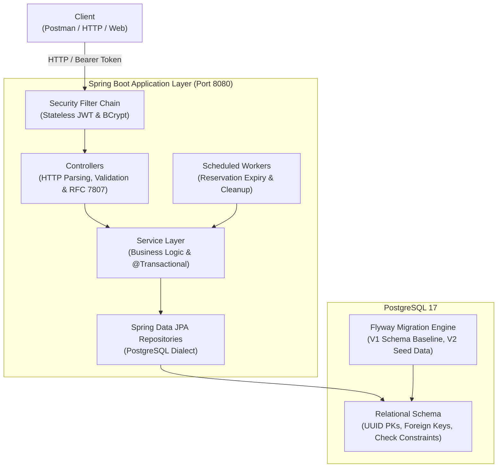

# 📚 Library Management REST API

> A production-grade backend REST API engineered with **Java 21**, **Spring Boot 3.4**, and **PostgreSQL**. Demonstrates atomic concurrency control, relational schema migrations, role-based JWT security, automated integration testing with Testcontainers, and multi-stage containerization.

[](https://github.com/ziad/library-api/actions)


[](https://opensource.org/licenses/MIT)

---

## 🌐 Interactive OpenAPI / Swagger UI

Interactive Swagger documentation is available at:
`http://localhost:8080/swagger-ui.html`

Live Cloud Deployment:
`https://library-api-prod.onrender.com/swagger-ui.html`

---

## ✨ Core Engineering Highlights

- **Atomic Concurrency Control:** Prevents race conditions during simultaneous borrows of the last available book copy using atomic conditional SQL updates, mathematically verified with multi-threaded integration tests.
- **Relational Integrity & Schema Evolution:** 100% version-controlled database migrations via **Flyway** with strict database check constraints (`0 <= available_copies <= total_copies`) and composite indexes.
- **Stateless Role-Based Security:** HMAC-SHA256 JWT authentication with role hierarchies (`MEMBER`, `LIBRARIAN`, `ADMIN`), BCrypt password hashing, and ownership verification in the service layer.
- **FIFO Reservation Queue:** First-come, first-served hold queues with automatic hold promotion upon return and an automated scheduled expiry worker.
- **RFC 7807 Problem Details:** Unified HTTP error reporting adhering to RFC 7807 standards with distinct problem types, timestamps, and field-level validation errors.
- **Deterministic Testing:** Complete dependency injection of a controllable `Clock`/`TimeProvider` for time-dependent loan renewals, late returns, fine computations, and hold expirations.
- **Production Parity Testing:** Integration tests run against real PostgreSQL instances via **Testcontainers**, guaranteeing dialect and constraint parity.
- **Hardened Multi-Stage Dockerfile:** Multi-stage image build running under an unprivileged `spring:spring` user with minimal Alpine JRE attack surface (< 250 MB).

---

## 🏗️ System Architecture



---

## 🚀 5-Minute Quick Start

### Prerequisites
- [Docker](https://www.docker.com/) & Docker Compose
- Or [Java 21 LTS](https://adoptium.net/) & PostgreSQL 17

### 1. Clone & Configure
```bash
git clone https://github.com/ziad/library-api.git
cd library-api
cp .env.example .env
```

### 2. Launch with Docker Compose
```bash
docker compose up -d
```

The database will initialize, Flyway will run all migrations and seed demo data, and the API will start on port `8080`.

### 3. Verify
```bash
curl http://localhost:8080/actuator/health
# Output: {"status":"UP"}
```
Explore the interactive API documentation at: **[http://localhost:8080/swagger-ui.html](http://localhost:8080/swagger-ui.html)**.

---

## 🔐 Seeded Demonstration Credentials

The application ships with development seed data (`V2__seed_data.sql`) ready for demonstration:

| Role | Email | Password | Allowed Capabilities |
|---|---|---|---|
| **ADMIN** | `admin@library.com` | `password123` | Full access, user role modification, user activation/deactivation |
| **LIBRARIAN** | `librarian@library.com` | `password123` | Catalog writes, book returns, fine settlements, circulation reports |
| **MEMBER** | `member@library.com` | `password123` | Catalog browsing, borrowing, renewals, reservations, personal fines |
| **MEMBER** | `bob.member@library.com` | `password123` | Secondary member account (for testing concurrent borrows) |

---

## 📋 Business Rules & Constraints

| Domain | Rule | Enforcement Mechanism |
|---|---|---|
| **Borrowing Limit** | Maximum 5 active loans per member | Service-layer validation (`countByUserIdAndStatus`) |
| **Duplicate Borrow** | Cannot hold two active loans of the same book | Database query check + conflict exception |
| **Delinquency Block** | Cannot borrow if any active loan is overdue or any fine is unpaid | Pre-borrow validation gate |
| **Loan Period** | 14 calendar days from borrow date | Configurable `@ConfigurationProperties` (`loanPeriodDays`) |
| **Concurrency** | Last copy cannot be double-borrowed | Atomic conditional `UPDATE books SET available_copies = available_copies - 1 WHERE id = ? AND available_copies > 0` |
| **Renewals** | Up to 2 renewals (each +14 days); blocked if overdue or reservations exist | Service validation gate |
| **Overdue Fines** | Assessed upon return: \$2.00/day overdue | `overdue_days * dailyFineRate` computed on return |
| **Reservations** | FIFO queue allowed only when 0 copies available; 3-day hold window | Reservation queue state machine (`WAITING` → `READY` → `FULFILLED` / `EXPIRED`) |

---

## 📖 API Endpoints Summary

All endpoints are prefixed with `/api/v1`.

### 🔑 Authentication & Users
| Method | Endpoint | Access | Description |
|---|---|---|---|
| `POST` | `/auth/register` | Public | Register new member |
| `POST` | `/auth/login` | Public | Authenticate and obtain JWT access token |
| `GET` | `/users/me` | Authenticated | View authenticated user profile |
| `PATCH` | `/users/{id}/role` | `ADMIN` | Update user role (`MEMBER`, `LIBRARIAN`, `ADMIN`) |
| `PATCH` | `/users/{id}/active` | `ADMIN` | Activate or deactivate account |

### 📚 Catalog (Books, Authors & Categories)
| Method | Endpoint | Access | Description |
|---|---|---|---|
| `GET` | `/books` | Public | Search books (title/author query, category, availability filter, pagination) |
| `GET` | `/books/{id}` | Public | Retrieve book details |
| `POST` | `/books` | `LIBRARIAN`, `ADMIN` | Create new catalog entry |
| `PUT` | `/books/{id}` | `LIBRARIAN`, `ADMIN` | Update book metadata and copy inventory |
| `DELETE` | `/books/{id}` | `LIBRARIAN`, `ADMIN` | Delete book (blocked if copies on loan) |
| `GET` | `/authors` | Public | List authors with search and pagination |
| `POST` | `/authors` | `LIBRARIAN`, `ADMIN` | Create author record |
| `GET` | `/categories` | Public | List all categories |
| `POST` | `/categories` | `LIBRARIAN`, `ADMIN` | Create category |

### 🔄 Circulation (Loans, Reservations & Fines)
| Method | Endpoint | Access | Description |
|---|---|---|---|
| `POST` | `/loans` | `MEMBER` | Borrow a book |
| `POST` | `/loans/{id}/return` | `LIBRARIAN`, `ADMIN` | Return book and assess overdue fines |
| `POST` | `/loans/{id}/renew` | `MEMBER` (Owner) | Extend due date by 14 days |
| `GET` | `/loans/me` | `MEMBER` | View personal loan history |
| `GET` | `/loans` | `LIBRARIAN`, `ADMIN` | Administrative loan query with overdue filter |
| `POST` | `/reservations` | `MEMBER` | Reserve unavailable title |
| `DELETE` | `/reservations/{id}` | `MEMBER` (Owner) | Cancel reservation |
| `GET` | `/reservations/me` | `MEMBER` | View personal reservations |
| `GET` | `/fines/me` | `MEMBER` | View personal fines |
| `POST` | `/fines/{id}/pay` | `LIBRARIAN`, `ADMIN` | Settle / mark fine as paid |

### 📊 Analytics & Reporting
| Method | Endpoint | Access | Description |
|---|---|---|---|
| `GET` | `/reports/overdue` | `LIBRARIAN`, `ADMIN` | Overdue loans list with borrower details and days late |
| `GET` | `/reports/popular-books` | `LIBRARIAN`, `ADMIN` | Most borrowed titles over given window (e.g. `?days=30&limit=10`) |
| `GET` | `/actuator/health` | Public | System and database health status |

---

## 🧪 Testing & Verification

The test suite combines Mockito unit tests for isolated domain rules with Testcontainers integration tests running against a real PostgreSQL container.

### Run All Tests Locally
```bash
./mvnw clean verify
```

### The Concurrency Proof Test
Located in `com.library.loan.LoanConcurrencyIntegrationTest`:
- Simulates two distinct members dispatching concurrent borrow requests for a book with exactly **1 copy available**.
- Coordinates execution using a `CountDownLatch` barrier across parallel worker threads.
- Proves that exactly **one** borrow succeeds (HTTP 201), the other is rejected with a conflict (HTTP 409), and database availability settles at exactly `0` copies.

---

## 📐 Architecture Decision Records (ADR)

Significant technical trade-offs are documented in [docs/DECISIONS.md](file:///Users/ziad/Desktop/library%20api/docs/DECISIONS.md):

- **[ADR-001](file:///Users/ziad/Desktop/library%20api/docs/DECISIONS.md#adr-001-primary-key-strategy-uuid-vs-auto-increment-bigint):** UUID vs. Auto-Increment Primary Keys (Security & distributed generation)
- **[ADR-002](file:///Users/ziad/Desktop/library%20api/docs/DECISIONS.md#adr-002-stateless-jwt-authentication--short-expiration):** Stateless JWT vs. Server-Side Sessions
- **[ADR-003](file:///Users/ziad/Desktop/library%20api/docs/DECISIONS.md#adr-003-password-hashing-with-bcrypt):** BCrypt Adaptive Hashing Strategy
- **[ADR-004](file:///Users/ziad/Desktop/library%20api/docs/DECISIONS.md#adr-004-concurrency-strategy-for-inventory-updates-atomic-conditional-update):** Atomic Conditional Update vs. Pessimistic / Optimistic Locking
- **[ADR-005](file:///Users/ziad/Desktop/library%20api/docs/DECISIONS.md#adr-005-schema-management-via-flyway-vs-hibernate-ddl-auto):** Versioned Flyway Migrations vs. Hibernate DDL Auto
- **[ADR-006](file:///Users/ziad/Desktop/library%20api/docs/DECISIONS.md#adr-006-multi-stage-dockerfile-with-least-privilege-execution):** Multi-Stage Containerization with Unprivileged User
- **[ADR-007](file:///Users/ziad/Desktop/library%20api/docs/DECISIONS.md#adr-007-integration-testing-with-testcontainers-postgresql-vs-in-memory-h2):** Testcontainers PostgreSQL vs. In-Memory H2

---

## ☁️ Cloud Deployment (Render / Railway)

This repository includes a 1-click declarative infrastructure blueprint:
- **Render:** Connect repository and select **New + Blueprint**; Render reads `render.yaml` to provision both the managed PostgreSQL database and the web service container automatically.
- **Railway:** Connect repository and deploy using the multi-stage `Dockerfile`.

---

## 📄 License

This project is licensed under the MIT License - see the [LICENSE](LICENSE) file for details.
